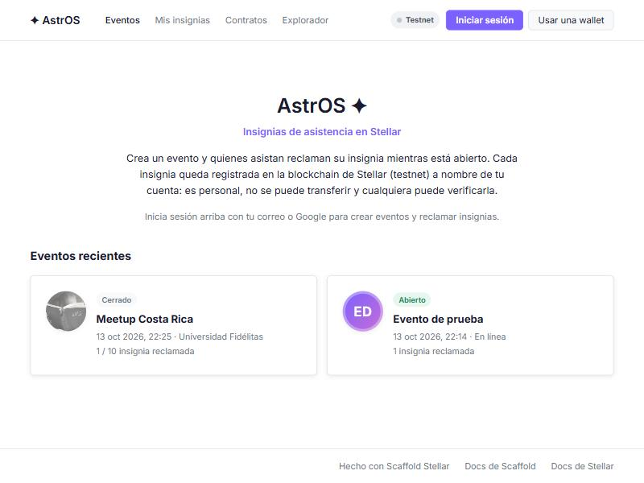

# AstrOS ✦

**Insignias de asistencia en Stellar.** Quien organiza crea un evento; quienes asisten reclaman su insignia mientras el evento está abierto y la guardan para siempre en su cuenta de Stellar. Inspirado en POAP (_proof of attendance protocol_), hecho como proyecto de aprendizaje sobre la testnet de Stellar.



- **Sin wallet ni frase semilla:** inicias sesión con tu correo o con Google gracias a [Cavos](https://cavos.xyz), y obtienes una cuenta de Stellar propia. Si prefieres, también funciona con Freighter.
- **Verificable:** cada insignia queda registrada en un contrato inteligente de Soroban. Nadie, ni siquiera quien organiza, puede quitártela o falsificarla.
- **Personal:** las insignias no se pueden transferir ni vender (_soulbound_): demuestran que esa cuenta estuvo ahí.

> ⚠️ AstrOS funciona solo en **testnet**: el dinero es de prueba y no tiene valor real.

## Cómo funciona

1. **Crear un evento.** Cualquier persona que inicie sesión puede crear uno con nombre, descripción, lugar, imagen (una URL), la ventana de fechas en la que se puede reclamar y, opcionalmente, un máximo de insignias. Quien lo crea queda como organizador.
2. **Compartir el enlace.** Cada evento tiene su página (`/evento/<id>`) con el botón «Copiar enlace».
3. **Reclamar la insignia.** Mientras el evento está abierto, cada cuenta puede reclamar **una** insignia. Se numeran por orden de llegada (#1, #2…).
4. **Coleccionar.** En «Mis insignias» ves todas las que reclamaste, leídas directamente de la blockchain.
5. **Cerrar.** Quien organiza puede cerrar el evento antes de tiempo; después nadie más puede reclamar.

Cada acción que escribe en la blockchain (crear, reclamar, cerrar) es una transacción que firmas con tu wallet y que paga una comisión mínima en XLM de prueba. Leer eventos e insignias es gratis y no requiere firma.

## Arquitectura

```
 Navegador (app/)                               Stellar testnet
 ┌──────────────────────────────┐              ┌─────────────────────────────┐
 │ React + Vite                 │   firma      │ Contrato attendance (Soroban)│
 │  ├ páginas Eventos / Evento / ├────────────▶│  eventos, insignias,        │
 │  │  Mis insignias            │              │  reglas de reclamo          │
 │  ├ cliente TS generado ──────┼── lecturas ─▶│                             │
 │  └ useWallet()               │              └─────────────────────────────┘
 │     ├ Cavos (correo/Google)  │
 │     └ Freighter y otras      │
 └──────────────────────────────┘
```

- **Contrato** [`contracts/attendance`](contracts/attendance/src/lib.rs) en Rust (soroban-sdk 26).
- **[Scaffold Stellar](https://stellarscaffold.org)** compila el contrato, lo despliega en testnet y genera su cliente de TypeScript cada vez que lo guardas.
- **Frontend** en React 19 con React Query: [`app/src/pages`](app/src/pages) y [`app/src/attendance`](app/src/attendance).
- **Wallets:** todo pasa por `useWallet()`, que funciona igual con Cavos y con extensiones como Freighter.
- No usa escrows (Trustless Work): en AstrOS nadie retiene dinero. El código de escrows que trae el template sigue en el repositorio, pero está fuera del menú.

### El contrato

| Función | Quién firma | Qué hace |
| --- | --- | --- |
| `create_event(organizer, name, description, location, image_url, starts_at, ends_at, max_claims)` | organizador | Crea un evento y devuelve su id. `max_claims = 0` es sin límite. |
| `claim(attendee, event_id)` | asistente | Reclama la insignia si el evento está abierto; devuelve su número. |
| `close_event(organizer, event_id)` | organizador | Cierra el evento antes de tiempo. |
| `get_event`, `event_count`, `latest_events(limit)` | nadie | Lecturas de eventos (las más recientes primero, máx. 50). |
| `get_badge(event_id, attendee)`, `badges_of(owner)` | nadie | Lecturas de insignias. |
| `upgrade(new_wasm_hash)` | admin | Actualiza el código sin perder datos (lo usa Scaffold al guardar). |

Reglas: texto de máximo 60 (nombre), 280 (descripción), 100 (lugar) y 200 (URL de imagen) caracteres; una insignia por cuenta y evento; máximo 100 insignias por cuenta. Los mensajes de error están en español y son los que ve la app. Emite los eventos `event_created`, `badge_claimed` y `event_closed`.

### Qué va en la blockchain y qué no

| Dato | Dónde | Por qué |
| --- | --- | --- |
| Eventos (nombre, fechas, lugar) e insignias | En el contrato | Deben ser públicos y verificables por cualquiera. |
| Imagen de la insignia | Fuera (solo se guarda la URL) | Las imágenes son demasiado grandes para guardarlas en la blockchain. |
| Correo electrónico y datos personales | Nunca en la blockchain | Lo público en la blockchain no se puede borrar. Tu correo queda en Cavos; en el contrato solo aparece tu dirección `G…`. |

### Límites honestos

- Reclamar está abierto a cualquiera durante la ventana del evento: prueba que **una cuenta reclamó durante el evento**, no que una persona estuvo físicamente presente.
- Una cuenta no es una persona: alguien podría usar varias cuentas.
- En testnet los datos viven unos 30 días desde su última escritura (TTL) y la red se reinicia de vez en cuando.

## Probarlo en tu computadora

### Requisitos

- [Node.js](https://nodejs.org) 22 o superior.
- [Rust](https://rustup.rs). En Windows también necesitas **Visual Studio C++ Build Tools** (o usa WSL2, que es lo recomendado).
- Git.

### Puesta en marcha

```bash
git clone https://github.com/Eco-RV/AstrOS.git
```

```bash
cd AstrOS
```

```bash
npm run setup:tools
```

```bash
npm install
```

```bash
npm run doctor
```

`setup:tools` instala Stellar CLI y el plugin de Scaffold. `doctor` revisa el entorno y crea `app/.env` a partir de `app/.env.example`.

### Configurar Cavos (inicio de sesión con correo o Google)

1. Crea una app en el [dashboard de Cavos](https://cavos.xyz/dashboard) y copia su **App ID** (pestaña _Overview_; es un UUID).
2. En la configuración de la app:
   - **Allowed web origins:** `http://localhost:5173`
   - **Callback URLs:** `http://localhost:5173/` (con la barra final; la ventana de Cavos envía la dirección de la página actual, así que inicia sesión desde la página principal).
3. En `app/.env`: `PUBLIC_CAVOS_APP_ID="<tu App ID>"`.

Usa solo el **App ID**, que es público. Las API keys de Cavos (empiezan con `cav_`) son secretas y no van en esta app. Sin App ID, la app funciona igual con Freighter.

### Iniciar

```bash
npm start
```

La primera vez tarda 1–2 minutos: crea y fondea la cuenta de despliegue `me`, compila los contratos, los despliega en testnet y genera sus clientes. Después abre http://localhost:5173. El comando sigue corriendo para recompilar al guardar; se detiene con `Ctrl+C`.

### Prueba rápida

1. **Iniciar sesión** con correo o Google (o «Usar una wallet» con Freighter en Testnet).
2. **Fondos de prueba:** recibe XLM de prueba para las comisiones. Hazlo antes de cualquier transacción.
3. **＋ Crear evento** con fechas que incluyan el momento actual.
4. En la página del evento, **Reclamar mi insignia** y confirma en la ventana de tu wallet.
5. Abre **Mis insignias**.

¿Necesitas imágenes de prueba? Usa por ejemplo `https://picsum.photos/seed/meetup/400` o `https://api.dicebear.com/9.x/shapes/svg?seed=MiEvento`.

## Comandos

| Comando | Qué hace |
| --- | --- |
| `npm start` | Contratos (compilar → desplegar en testnet → clientes TS) + app en http://localhost:5173 |
| `npm run contracts:build` | Compila, despliega y genera clientes una sola vez |
| `npm run contracts:test` | Tests de los contratos (`cargo test`) |
| `npm run check` | Tests + formato + typecheck + lint (córrelo antes de subir cambios) |
| `npm run doctor` | Diagnóstico del entorno |

Para invocar el contrato desde la terminal (desde `app/`):

```bash
stellar contract invoke --id attendance --source me --network testnet -- latest_events --limit 5
```

## Estructura

```
contracts/attendance/     contrato de eventos e insignias + tests
app/src/pages/            Events (/), EventDetail (/evento/:id), MyBadges (/insignias), Debug (/debug)
app/src/attendance/       hooks del contrato, formulario de evento, arte de las insignias
app/src/cavos/            inicio de sesión con Cavos (@cavos/kit 0.4.2)
app/src/providers/        WalletProvider: un único useWallet() para Cavos y extensiones
environments.toml         contratos por entorno (development local, staging, production)
Versionamiento/           cambios a los contratos desplegados, por versión
scripts/ci-clients.mjs    genera los clientes TS para Vercel y CI (sin Rust)
vercel.json               despliegue en Vercel
app/.env                  configuración pública (no se sube a git)
.agents/skills/           guías para agentes de código (Claude Code, Codex, Cursor…)
```

## Flujo de trabajo

`feature/x.y.z` → PR a `dev_main` (staging, Preview de Vercel) → PR a `main` (producción) → etiqueta `vx.y.z` + release. Cada entorno tiene sus propios contratos en testnet; los cambios a contratos ya desplegados se hacen con `upgrade` y se documentan en `Versionamiento/`. Detalle completo en [docs/FLUJO.md](docs/FLUJO.md); historial en [CHANGELOG.md](CHANGELOG.md).

## Problemas comunes en Windows

- **`npm install` falla con `"yarn" no se reconoce`:** una dependencia ejecuta un script que no funciona en `cmd`. Usa `npm install --ignore-scripts` y después `npm run agents:sync`.
- **`npm run check` marca todos los archivos con errores de formato:** Git convirtió los saltos de línea a CRLF. Ejecuta `git config core.autocrlf false` y `git config core.eol lf` en el repositorio y vuelve a sacar los archivos.
- **Cambié un contrato y no se desplegó:** el modo de vigilancia a veces no detecta el cambio en Windows. Guarda de nuevo o ejecuta `npm run contracts:build`.
- **Freighter dice «localhost is not currently connected»:** conecta la wallet desde el botón de la app y aprueba el sitio en Freighter (red Testnet).

Para todo lo demás: `npm run doctor`.

## Ideas para seguir

- Código QR por evento para reclamar desde el celular.
- Código secreto o aprobación del organizador para demostrar asistencia real.
- Página pública con las insignias de cualquier cuenta (`/insignias/<G…>`).
- Notificaciones en vivo con los eventos `badge_claimed`.

## Créditos y licencia

AstrOS se construyó a partir de [scaffold-stellar-agentic](https://github.com/bitfalt/scaffold-stellar-agentic), basado en el template oficial de [Scaffold Stellar](https://github.com/stellar-scaffold/ui) de The Aha Company y sus contribuidores (Apache-2.0). El detalle de qué proviene del template está en [`NOTICE`](NOTICE). Usa [`@cavos/kit`](https://docs.cavos.xyz) (MIT). Se distribuye bajo la licencia [Apache-2.0](LICENSE).
